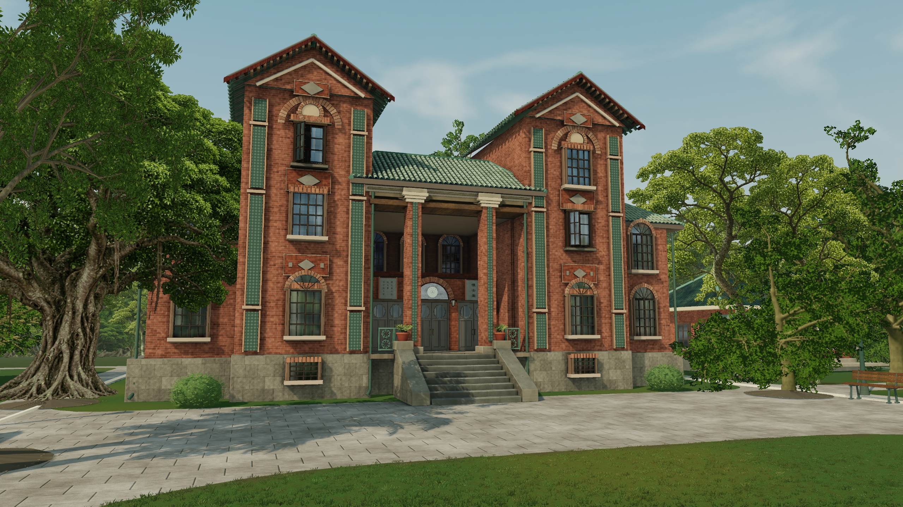
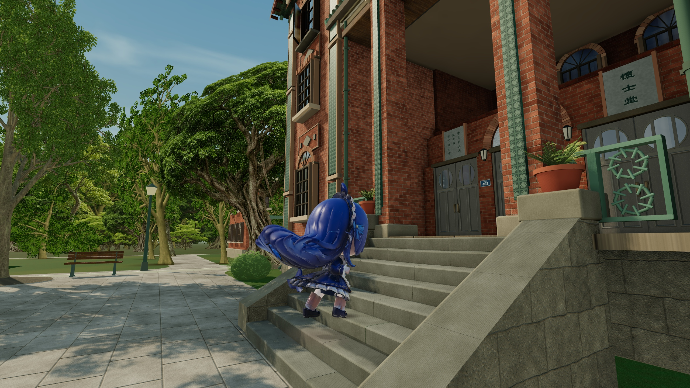

# 康乐园漫游志

从怀士堂门前的草坪出发，沿石阶走进红砖柱廊，抬头看绿瓦和塔楼。你可以自由转动镜头，也可以操纵角色步行探索中山大学广州校区南校园。

**[进入游戏](https://xunguangzlj-cloud.github.io/kangle-campus-walk/)** · [游览完整校园中轴](https://xunguangzlj-cloud.github.io/kangle-campus-walk/?scene=campus)

## 游戏画面

两张图均截自线上游戏，原图为 2560 × 1440。点击可查看大图。

## 怎样玩

| 操作 | 方式 |
| --- | --- |
| 浏览建筑 | 鼠标拖动旋转，滚轮缩放，按住右键拖动可平移 |
| 进入人物模式 | 点击页面顶部「人物漫游」 |
| 走、跑、跳 | WASD 或方向键移动，按住 Shift 奔跑，空格跳跃 |
| 切换视角 | V 在第一、第三人称间切换，Esc 返回总览 |
| 触屏 | 浏览时单指旋转、双指缩放。人物模式下用摇杆移动，拖动画面转头，点按钮跳跃 |

在画面右上角可以切换午后晴光和清晨薄雾。本作是校园局部的艺术重建，植被位置和部分距离经过简化。

## 离线游玩与修改

在线试玩会先载入当前场景，进入庭院后再补齐高清材质。点击「人物漫游」才下载人物，先载入可以行走的模型，再补齐近景细节。

要离线游玩，下载[完整单文件 offline.html](https://github.com/xunguangzlj-cloud/kangle-campus-walk/raw/refs/heads/main/offline.html)，用开启图形加速的现代浏览器打开。文件约 52.4 MiB，包含 Three.js 引擎、场景、材质、人物和动画。

要调整某一项，可在 HTML 内搜索函数名。怀士堂主体由 `createHall` 生成，门窗和台阶分别在 `entranceCraft`、`courtTreads` 中，庭前植被在 `courtLandscape` 中，人物移动和视角由 `makeWalker` 控制。开发者控制台的 `campus.components` 可以查看场景中的独立组件。

## 参考作品与致谢

- **人物传输压缩**　感谢 Arseny Kapoulkine 开发 meshoptimizer，用于压缩线上版的角色网格与动画。[meshoptimizer](https://github.com/zeux/meshoptimizer)

- **人物与动画**　本作使用《暖光玩具房》网页试玩中的蓝发角色模型、贴图、骨骼和动作。感谢原作制作团队创作角色造型与走、跑、跳的动作。校园中的跟拍、碰撞和楼梯贴脚在原动作基础上实现。[《暖光玩具房》原作试玩](https://v25.dafeiyugame.site/)
- **建筑照片**　感谢维基共享资源贡献者**猫猫的日记本**拍摄的 2016 年北立面正面照，以及 **AlexHe34** 拍摄的 2011 年斜侧照。两张照片用于核对塔楼、屋脊、门窗与石阶比例。[2016 年正面照](https://commons.wikimedia.org/wiki/File:Swasey_Hall_of_Lingnan_University_03_2016-05.jpg)（[CC BY-SA 4.0](https://creativecommons.org/licenses/by-sa/4.0/deed.zh-hans)） · [2011 年斜侧照](https://commons.wikimedia.org/wiki/File:Huaishi_Hall_of_SYSU.jpg)（[CC BY-SA 3.0](https://creativecommons.org/licenses/by-sa/3.0/deed.zh-hans)）
- **航拍与实走**　感谢 B 站 UP 主**潇庭木下**记录怀士堂与草坪的空间关系，**汤圆妈妈爱遛娃**拍下正门近景，**飞翔xmfly**提供南校园中轴全景。[潇庭木下《航拍中山大学怀士堂毕业季风貌》](https://www.bilibili.com/video/BV1Kt41137fX/?t=18) · [汤圆妈妈爱遛娃《听劝！去中山大学南校区参观之前，一定要看完这篇攻略视频》](https://www.bilibili.com/video/BV1ej411W7UY/?t=44) · [飞翔xmfly《航拍985校园之中山大学南校园完整版》](https://www.bilibili.com/video/BV12mydYWE2o/)
- **校史与碑文**　感谢中山大学及教育发展基金会公开建筑图文、校园地图和碑刻资料。门旁云石原题由商承祚书写，游戏内的文字按校方记载重新排字。[怀士堂建筑资料](https://wgb.sysu.edu.cn/article/194) · [校园地图册](https://cse.sysu.edu.cn/node/1343) · [碑文资料](https://edf-edaao.sysu.edu.cn/article/517)
- **开源工具**　感谢 Three.js 贡献者提供实时渲染、相机控制与模型加载工具，Daniel Greenheck 开发 EZ Tree 程序化树木工具，以及 TripoSR 团队提供离线三维重建工具。[Three.js](https://github.com/mrdoob/three.js) · [EZ Tree](https://github.com/dgreenheck/ez-tree) · [TripoSR](https://github.com/VAST-AI-Research/TripoSR)
